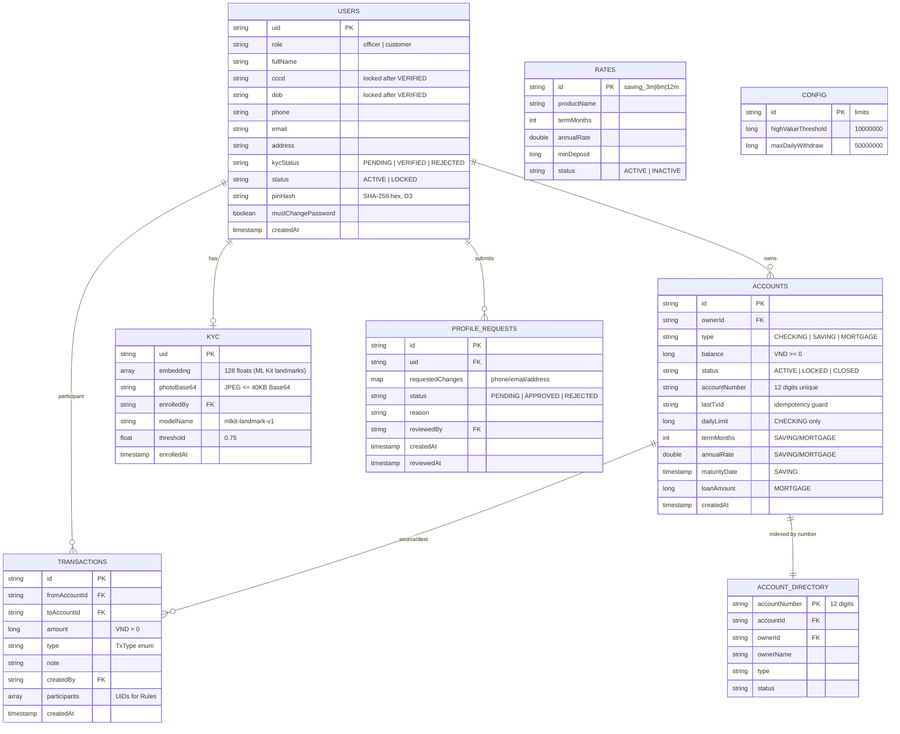

# Diagrams — Mobile Banking App TDTU

> Owner: Dev A | Cập nhật: D3 | Package: `com.tdtu.mobilebanking`

---

## 1. Use Case Diagram

> Render bằng PlantUML (paste vào https://www.plantuml.com/plantuml/uml/)

```plantuml
@startuml MobileBankingUseCases
left to right direction
skinparam packageStyle rectangle
skinparam actorStyle awesome

actor "Customer" as C
actor "Officer" as O
actor "Firebase Auth" as FA <<system>>
actor "Firestore" as FS <<system>>
actor "Gemini AI" as AI <<system>>

rectangle "Authentication" {
  usecase "UC-01\nĐăng nhập" as UC01
  usecase "UC-02\nQuên mật khẩu" as UC02
  usecase "UC-03\nĐăng xuất" as UC03
  usecase "UC-04\nTự động đăng nhập\n(session còn hạn)" as UC04
}

rectangle "Customer Profile (A5)" {
  usecase "UC-10\nXem hồ sơ cá nhân" as UC10
  usecase "UC-11\nYêu cầu sửa hồ sơ\n(phone/email/address)" as UC11
  usecase "UC-12\nĐổi mật khẩu" as UC12
  usecase "UC-13\nĐổi PIN giao dịch" as UC13
}

rectangle "eKYC (A4, A7)" {
  usecase "UC-20\nChụp CCCD\n(OCR tự động)" as UC20
  usecase "UC-21\nXác minh CCCD\nvới hồ sơ" as UC21
  usecase "UC-22\nĐăng ký khuôn mặt\n(Face Enroll)" as UC22
  usecase "UC-23\nXác thực khuôn mặt\n(giao dịch lớn)" as UC23
}

rectangle "Officer — KYC & Accounts" {
  usecase "UC-30\nTạo tài khoản\nkhách hàng" as UC30
  usecase "UC-31\nMở tài khoản\n(Saving/Mortgage)" as UC31
  usecase "UC-32\nDuyệt yêu cầu\nsửa hồ sơ" as UC32
  usecase "UC-33\nTừ chối yêu cầu\nsửa hồ sơ" as UC33
  usecase "UC-34\nNạp tiền tại quầy\n(COUNTER_DEPOSIT)" as UC34
  usecase "UC-35\nQuản lý lãi suất" as UC35
}

rectangle "Transactions (Dev B)" {
  usecase "UC-40\nChuyển khoản\nnội bộ" as UC40
  usecase "UC-41\nXem lịch sử\ngiao dịch" as UC41
  usecase "UC-42\nXác nhận giao dịch\n(PIN / Face)" as UC42
}

rectangle "Utilities (Dev C)" {
  usecase "UC-50\nTìm ATM/Chi nhánh\n(Maps)" as UC50
  usecase "UC-51\nChatbot AI\n(Gemini)" as UC51
  usecase "UC-52\nTính lãi suất\ntiết kiệm" as UC52
}

C --> UC01 ; C --> UC02 ; C --> UC03 ; C --> UC04
C --> UC10 ; C --> UC11 ; C --> UC12 ; C --> UC13
C --> UC20 ; C --> UC21 ; C --> UC22 ; C --> UC23
C --> UC40 ; C --> UC41 ; C --> UC42
C --> UC50 ; C --> UC51 ; C --> UC52

O --> UC01 ; O --> UC03
O --> UC30 ; O --> UC31 ; O --> UC32 ; O --> UC33 ; O --> UC34 ; O --> UC35

UC01 ..> FA : <<use>>
UC02 ..> FA : <<use>>
UC12 ..> FA : <<use>>
UC10 ..> FS : <<use>>
UC11 ..> FS : <<use>>
UC30 ..> FS : <<use>>
UC40 ..> FS : <<use>>
UC51 ..> AI : <<use>>

UC11 ..> UC32 : <<extend>>\nofficer reviews
UC42 ..> UC23 : <<include>>\nif amount >= 10M

@enduml
```

---

## 2. Class Diagram — Auth / User / Officer / KYC Package (Dev A)

> Render bằng PlantUML (paste vào https://www.plantuml.com/plantuml/uml/)

```plantuml
@startuml MobileBankingClassDiagram
skinparam classAttributeIconSize 0
skinparam classFontSize 12
skinparam groupInheritance 2

' ===================== MODELS =====================

package "common.model" {

  class User {
    + String uid
    + String role
    + String fullName
    + String cccd
    + String dob
    + String phone
    + String email
    + String address
    + String kycStatus
    + String status
    + String pinHash
    + boolean mustChangePassword
    + Date createdAt
  }

  abstract class Account {
    + String id
    + String ownerId
    + String type
    + long balance
    + String status
    + String accountNumber
    + String lastTxId
    + Date createdAt
  }

  class CheckingAccount {
    + long dailyLimit
  }

  class SavingAccount {
    + int termMonths
    + double annualRate
    + long minDeposit
    + Date maturityDate
  }

  class MortgageAccount {
    + long loanAmount
    + int termMonths
    + double annualRate
    + Date startDate
  }

  class ProfileRequest {
    + String id
    + String uid
    + Map<String,String> requestedChanges
    + String status
    + String reason
    + String reviewedBy
    + Date createdAt
    + Date reviewedAt
  }

  class TxRequest {
    + String id
    + String fromAccountId
    + String toAccountId
    + long amount
    + TxType type
    + String note
    + String createdBy
    + List<String> participants
    + Date createdAt
  }

  enum TxType {
    INTERNAL_TRANSFER
    DEPOSIT
    WITHDRAWAL
    SAVING_OPEN
    MORTGAGE_PAYMENT
    COUNTER_DEPOSIT
  }

  Account <|-- CheckingAccount
  Account <|-- SavingAccount
  Account <|-- MortgageAccount
  TxRequest --> TxType
}

' ===================== AUTH =====================

package "auth" {

  class AuthRepository {
    - FirebaseAuth auth
    - FirebaseFirestore db
    + login(email, password) : Task
    + register(email, password) : Task
    + resetPassword(email) : Task
    + logout() : void
    + getCurrentUser() : FirebaseUser
    + fetchRole(uid) : Task<String>
  }

  class AuthViewModel {
    - AuthRepository repo
    - MutableLiveData<FirebaseUser> currentUser
    - MutableLiveData<String> role
    + isLoggedIn() : boolean
    + login(email, pwd) : void
    + resetPassword(email) : void
    + fetchCurrentUserRole() : void
    + logout() : void
  }

  class LoginFragment {
    - AuthViewModel viewModel
    + onViewCreated()
    - doLogin()
    - routeByRole(role)
    - setLoading(boolean)
  }

  class RegisterFragment {
    - AuthViewModel viewModel
    + onViewCreated()
  }

  class ForgotPasswordFragment {
    - AuthViewModel viewModel
    + onViewCreated()
  }

  AuthViewModel --> AuthRepository
  LoginFragment --> AuthViewModel
  RegisterFragment --> AuthViewModel
  ForgotPasswordFragment --> AuthViewModel
}

' ===================== PROFILE =====================

package "profile" {

  class CustomerProfileFragment {
    - FirebaseFirestore db
    - FirebaseUser currentUser
    - String originalPhone
    - String originalEmail
    - String originalAddress
    + onViewCreated()
    - loadProfile()
    - submitChanges()
    - setLoading(boolean)
  }

  class ChangePasswordFragment {
    + onViewCreated()
    - changePassword()
    - isValidPassword(pwd) : boolean
  }

  class ChangePinFragment {
    - FirebaseFirestore db
    + onViewCreated()
    - changePin()
    - sha256(input) : String
  }
}

' ===================== OFFICER =====================

package "officer" {

  class OfficerKycHelper {
    - FirebaseFirestore db
    - boolean busy
    + createCustomerAccount(..., Callback) : void
    - writeProfileAndAccount(...) : void
    - buildProfile(...) : Map
    - newAccountNumber() : String
    - getSecondaryApp() : FirebaseApp
    - validate(...) : String
    interface Callback {
      + onSuccess(uid, accountId, number)
      + onError(message)
    }
  }

  class OfficerHomeFragment {
    + onViewCreated()
  }

  class CreateCustomerFragment {
    - OfficerKycHelper helper
    + onViewCreated()
    - doCreate()
  }

  class OpenAccountFragment {
    - OfficerKycHelper helper
    + onViewCreated()
    - openAccount()
  }

  class ProfileRequestsFragment {
    - FirebaseFirestore db
    - ProfileRequestAdapter adapter
    + onViewCreated()
    - loadRequests()
  }

  class ProfileRequestDetailFragment {
    - FirebaseFirestore db
    - String requestId
    - String customerUid
    + onViewCreated()
    - loadRequest()
    - approve(changes)
    - showRejectDialog()
    - reject(reason)
  }

  class ProfileRequestAdapter {
    - List<DocumentSnapshot> items
    - OnClickListener listener
    + submitList(docs) : void
    interface OnClickListener {
      + onClick(requestId)
    }
  }

  CreateCustomerFragment --> OfficerKycHelper
  OpenAccountFragment --> OfficerKycHelper
  ProfileRequestsFragment --> ProfileRequestAdapter
  OfficerHomeFragment --> CreateCustomerFragment : navigates
  OfficerHomeFragment --> OpenAccountFragment : navigates
  OfficerHomeFragment --> ProfileRequestsFragment : navigates
  ProfileRequestsFragment --> ProfileRequestDetailFragment : navigates
}

' ===================== KYC =====================

package "kyc" {

  interface KycVerifier {
    + verify(uid, context, Callback) : void
    interface Callback {
      + onVerified()
      + onFailed(reason)
    }
  }

  class FakeKycVerifier {
    + verify(uid, context, Callback) : void
  }

  class KycCccdFragment {
    - TextRecognizer recognizer
    - ProcessCameraProvider cameraProvider
    - String scannedCccd
    - String scannedName
    - String scannedDob
    - boolean scanDone
    + onViewCreated()
    - startCamera()
    - analyzeFrame(proxy)
    - parseOcrResult(text)
    - verify()
    - normalize(s) : String
  }

  class KycFaceEnrollFragment {
    - FaceDetector faceDetector
    - ImageCapture imageCapture
    - int stableFrameCount
    - boolean capturing
    + onViewCreated()
    - startCamera()
    - analyzeFrame(proxy)
    - capturePhoto(face)
    - compressToBase64(bmp) : String
    - buildEmbedding(face) : List<Float>
    - saveToFirestore(base64, embedding) : void
  }

  class KycFaceVerifyFragment {
    <<stub — D4>>
    + onViewCreated()
  }

  class KycResultFragment {
    + onViewCreated()
  }

  FakeKycVerifier ..|> KycVerifier
  KycFaceVerifyFragment ..|> KycVerifier
}

' ===================== CONTRACTS =====================

package "common.contract" {
  interface AccountRepository {
    + getAccountsForUser(uid) : Task
    + getAccountById(id) : Task
    + findByAccountNumber(number) : Task
  }
  interface OtpService {
    + sendOtp(phone, Callback) : void
    + verifyOtp(otp) : boolean
  }
  interface TransactionService {
    + executeTransfer(TxRequest) : Task
    + getTransactionHistory(uid) : Task
  }
}

@enduml
```

---

## 3. ERD — Firestore Collections



---

## 4. Data Dictionary

### `users/{uid}`
| Field | Type | Ràng buộc | Ghi chú |
|-------|------|-----------|---------|
| uid | string | PK, NOT NULL | = Firebase Auth UID |
| role | string | officer \| customer | Phân quyền, không tự sửa được |
| cccd | string | 12 chữ số | Lock sau kycStatus=VERIFIED |
| kycStatus | string | PENDING\|VERIFIED\|REJECTED | default PENDING |
| pinHash | string | SHA-256 hex, nullable | Null nếu chưa set PIN |
| status | string | ACTIVE\|LOCKED | Officer set, default ACTIVE |
| mustChangePassword | boolean | — | Officer set true khi tạo TK |

### `accounts/{id}`
| Field | Type | Ràng buộc | Ghi chú |
|-------|------|-----------|---------|
| balance | long | ≥ 0, VND | Không dùng double/float |
| accountNumber | string | 12 chữ số, unique | Lookup qua accountDirectory |
| lastTxId | string | nullable | Idempotency: txId cuối cùng |
| type | string | CHECKING\|SAVING\|MORTGAGE | Quyết định fields bổ sung |

### `transactions/{id}`
| Field | Type | Ràng buộc | Ghi chú |
|-------|------|-----------|---------|
| amount | long | > 0, VND | Luôn dương |
| participants | array | [fromOwner, toOwner] | Dùng để Security Rules read |
| type | enum | TxType | 6 loại (xem TxType) |

### `kyc/{uid}`
| Field | Type | Ràng buộc | Ghi chú |
|-------|------|-----------|---------|
| embedding | array(float) | 128 dims | ML Kit landmark pseudo-embedding |
| photoBase64 | string | ≤ 40KB JPEG | Spark plan — không dùng Firebase Storage |
| threshold | float | default 0.75 | Cosine similarity cutoff cho verify |

---

## 5. Composite Indexes (cần tạo trên Firestore Console)

| Collection | Field 1 | Field 2 | Order | Dùng bởi |
|-----------|---------|---------|-------|---------|
| `transactions` | `participants` ASC | `createdAt` DESC | Composite | Lịch sử giao dịch user |
| `profileRequests` | `status` ASC | `createdAt` ASC | Composite | Officer xem PENDING |
| `accounts` | `ownerId` ASC | `type` ASC | Composite | List tài khoản theo loại |

> **Tạo index**: Firestore Console → **Indexes** tab → **Composite** → Add index
