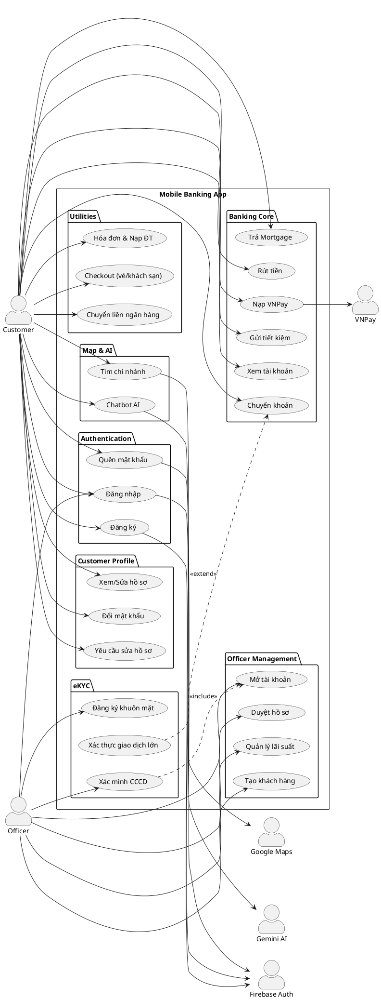

# Use Case Diagram — Mobile Banking App

> Môn: Mobile Apps Development | Nhóm: 3 thành viên (Dev A, Dev B, Dev C)  
> Owner: Dev A | Phiên bản: 1.0 | Ngày: D1

---

## Actors

| Actor | Mô tả |
|-------|--------|
| **Customer** | Khách hàng đã đăng ký và được xác thực |
| **Officer** | Nhân viên ngân hàng (có quyền cao hơn) |
| **Firebase Auth** | Hệ thống xác thực |
| **Firestore** | Cơ sở dữ liệu |
| **VNPay Gateway** | Cổng thanh toán VNPay (sandbox) |
| **Google Maps** | Dịch vụ bản đồ |
| **Gemini AI** | Chatbot AI (Firebase AI Logic) |

---

## Use Case List

### 🔐 Authentication (UC-AUTH)

```
UC-AUTH-01: Đăng nhập
  Actor: Customer / Officer
  Precondition: Chưa đăng nhập
  Flow: Nhập email + password → Firebase Auth → Role routing
  Alt: Sai credentials → Hiện thông báo lỗi

UC-AUTH-02: Đăng ký tài khoản
  Actor: Customer (tự đăng ký)
  Flow: Nhập thông tin (tên, CCCD, ngày sinh, email, SĐT) → Tạo Firebase Auth user → Tạo users/{uid} với kycStatus=PENDING

UC-AUTH-03: Quên mật khẩu
  Actor: Customer / Officer
  Flow: Nhập email → Firebase gửi reset link → Redirect về Login

UC-AUTH-04: Đăng xuất
  Actor: Customer / Officer
  Flow: Clear session → Navigate về màn Login
```

### 👮 Officer Management (UC-OFF)

```
UC-OFF-01: Tạo khách hàng mới
  Actor: Officer
  Flow: Nhập thông tin khách → Firebase App phụ createUser → Ghi users/{uid} qua Firestore chính → Không bị đăng xuất
  Note: Dùng FirebaseApp phụ để tránh đăng xuất officer

UC-OFF-02: Tìm kiếm khách hàng
  Actor: Officer
  Flow: Nhập tên / CCCD / email → Query Firestore → Hiện danh sách kết quả

UC-OFF-03: Xem chi tiết khách hàng
  Actor: Officer
  Includes: UC-OFF-02

UC-OFF-04: Sửa thông tin khách hàng
  Actor: Officer
  Flow: Chọn trường sửa → Cập nhật users/{uid} → Lưu lịch sử

UC-OFF-05: Mở tài khoản Checking
  Actor: Officer
  Flow: Chọn khách → Nhập dailyLimit → Tạo accounts/{id} type=CHECKING

UC-OFF-06: Mở tài khoản Saving
  Actor: Officer
  Flow: Chọn khách → Chọn productId (rates/{productId}) → Nhập principal, termMonths → Tạo SavingAccount

UC-OFF-07: Mở tài khoản Mortgage
  Actor: Officer
  Flow: Chọn khách → Nhập principal, annualRate, termMonths, frequency, startDate → Tạo MortgageAccount

UC-OFF-08: Duyệt yêu cầu sửa hồ sơ
  Actor: Officer
  Flow: Xem danh sách profileRequests PENDING → Duyệt hoặc Từ chối kèm lý do → Cập nhật users/{uid}

UC-OFF-09: Quản lý lãi suất tiết kiệm
  Actor: Officer
  Flow: Xem/Sửa rates/{productId} → Lưu → Áp dụng cho sản phẩm mới
```

### 🪪 eKYC (UC-KYC)

```
UC-KYC-01: Đăng ký khuôn mặt (Officer hỗ trợ)
  Actor: Officer + Customer
  Flow: Officer mở màn eKYC cho khách → CameraX chụp ảnh mặt → ML Kit Face Detection → TFLite embedding → Lưu kyc/{uid}
  postcondition: kycStatus giữ nguyên PENDING cho đến khi A7 hoàn thành

UC-KYC-02: Chụp CCCD và xác minh (A7)
  Actor: Customer / Officer
  Flow: CameraX chụp ảnh CCCD → ML Kit Text Recognition đọc tên/CCCD/ngày sinh → So khớp với users/{uid} → kycStatus=VERIFIED/REJECTED

UC-KYC-03: Xác thực khuôn mặt cho giao dịch lớn
  Actor: Customer
  Trigger: amount >= config/limits.highValueThreshold (10.000.000đ)
  Flow: Mở camera → TFLite so embedding với kyc/{uid} → cosine similarity ≥ ngưỡng → Pass/Fail
  Alt: Blink liveness detection nếu embedding không đủ chắc

UC-KYC-04: Yêu cầu sửa hồ sơ (Customer)
  Actor: Customer
  Flow: Chọn trường muốn sửa (phone/email/address/...) → Nhập giá trị mới → Tạo profileRequests/{id} → Chờ Officer duyệt
```

### 👤 Customer Profile (UC-PRO)

```
UC-PRO-01: Xem hồ sơ cá nhân
  Actor: Customer
  Flow: Đọc users/{uid} → Hiển thị thông tin

UC-PRO-02: Sửa thông tin cá nhân (phone/email/address)
  Actor: Customer
  Flow: Nhập giá trị mới → Update users/{uid} (chỉ 3 trường) → Security Rules validate

UC-PRO-03: Đổi mật khẩu
  Actor: Customer
  Flow: Nhập mật khẩu cũ → Firebase re-authenticate → Nhập mật khẩu mới → Update

UC-PRO-04: Đổi PIN giao dịch
  Actor: Customer
  Flow: Nhập PIN cũ → Xác thực → Nhập PIN mới (6 số) → Lưu hash vào Firestore
  Note: PIN lưu riêng trong users/{uid}.pinHash

UC-PRO-05: Xem kycStatus
  Actor: Customer
  Flow: Hiển thị trạng thái KYC trên Profile (PENDING/VERIFIED/REJECTED)
```

### 💳 Account & Transaction (UC-TXN — Dev B)

```
UC-TXN-01: Xem danh sách tài khoản
UC-TXN-02: Xem số dư tài khoản Checking
UC-TXN-03: Xem lịch sử giao dịch (tham số month)
UC-TXN-04: Rút tiền
UC-TXN-05: Chuyển khoản nội bộ (OTP + eKYC nếu ≥ ngưỡng)
UC-TXN-06: Nạp tiền qua VNPay (sandbox)
UC-TXN-07: Gửi tiết kiệm
UC-TXN-08: Tất toán tiết kiệm
UC-TXN-09: Trả kỳ Mortgage
  → Tất cả đi qua ConfirmTransactionFragment (B sở hữu)
```

### 🏦 Saving & Mortgage (UC-SAV — Dev C)

```
UC-SAV-01: Xem chi tiết tài khoản Saving (lãi suất, lợi nhuận/tháng)
UC-SAV-02: Xem lịch trả nợ Mortgage (annuity, monthly/biweekly)
UC-SAV-03: Chuyển liên ngân hàng
```

### 🛒 Utilities (UC-UTL — Dev C)

```
UC-UTL-01: Thanh toán hóa đơn điện
UC-UTL-02: Thanh toán hóa đơn nước
UC-UTL-03: Nạp điện thoại
UC-UTL-04: Mua vé máy bay (màn checkout chung)
UC-UTL-05: Mua vé xem phim (màn checkout chung)
UC-UTL-06: Đặt khách sạn (màn checkout chung)
UC-UTL-07: Mua sắm e-commerce (màn checkout chung)
  → UC-UTL-01 đến 07 đều đi qua ConfirmTransactionFragment
```

### 🗺️ Maps & Chatbot (UC-MAP, UC-BOT — Dev C)

```
UC-MAP-01: Xem bản đồ chi nhánh
UC-MAP-02: Tìm chi nhánh gần nhất (Haversine → 3 chi nhánh)
UC-MAP-03: Tính đường đi bộ ngắn nhất (Routes API computeRoutes WALK)

UC-BOT-01: Chat với AI Chatbot (Gemini)
UC-BOT-02: Điều hướng qua deep link (5 route: pay_phone, pay_bills, history, transfer, branches)
```

---

## Use Case Diagram (Text/PlantUML format)



---

## Mô tả quan hệ giữa actors

| Quan hệ | Mô tả |
|---------|--------|
| Customer `<<include>>` eKYC | Customer phải hoàn thành eKYC trước khi giao dịch |
| Giao dịch ≥ 10M `<<extend>>` KYC verify | Chỉ kích hoạt khi amount vượt ngưỡng |
| Officer `<<include>>` Tạo tài khoản | Phải tạo khách trước khi mở tài khoản |
| Mọi giao dịch tiền `<<include>>` ConfirmTransaction | Pipeline B2 bắt buộc |
| ConfirmTransaction `<<include>>` OTP | B3 bắt buộc với mọi giao dịch |
